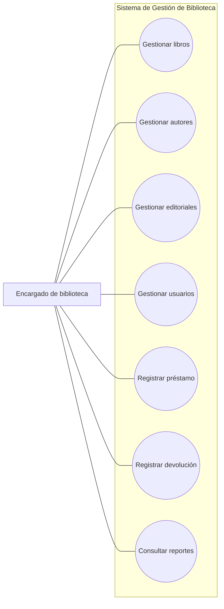
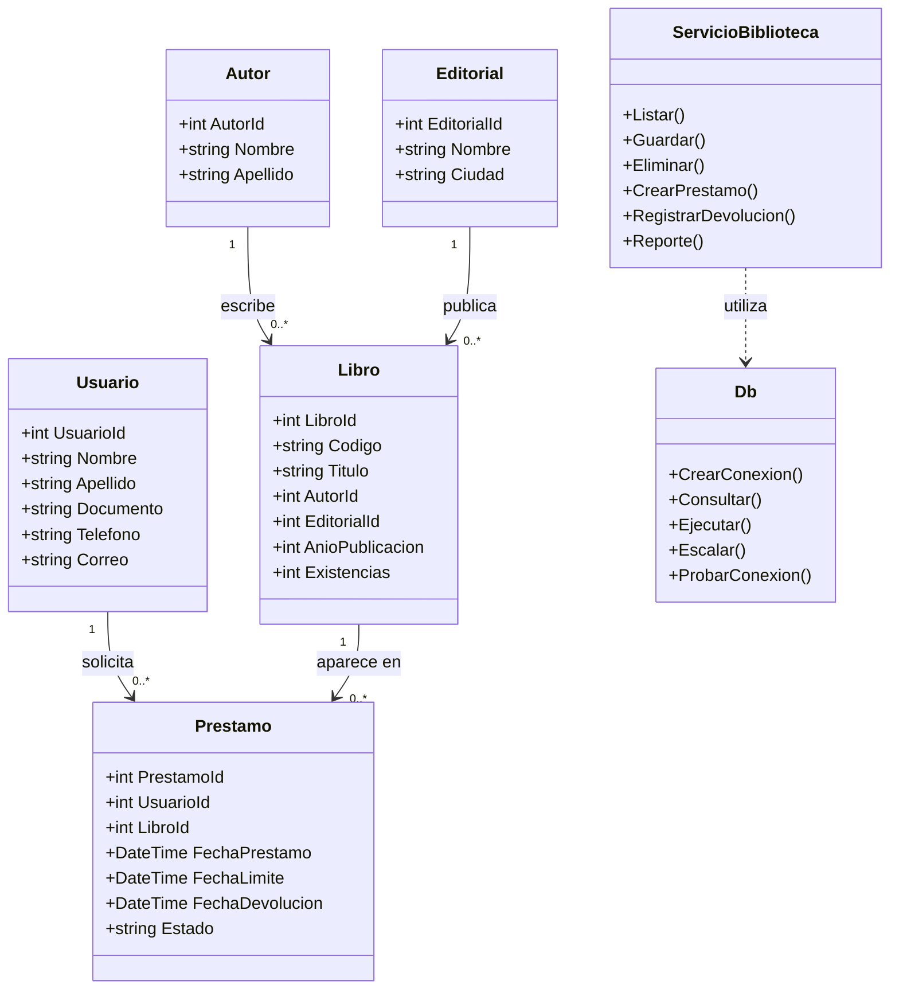
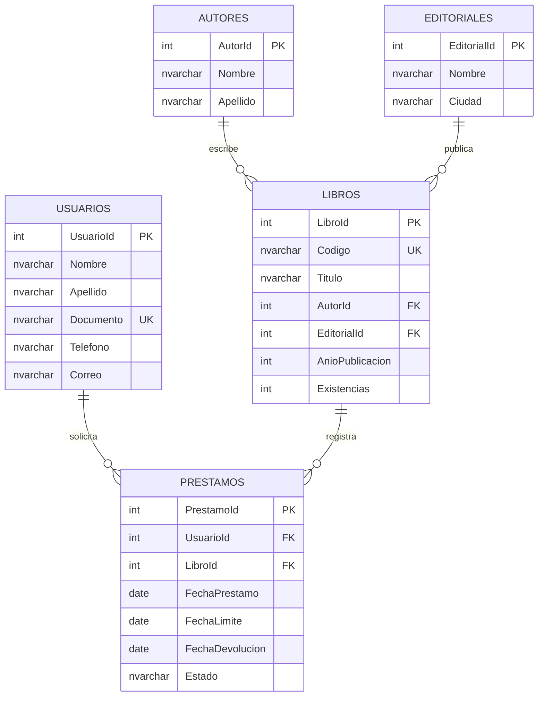

# SISTEMA DE GESTIÓN DE BIBLIOTECA

**ACA – Programación Avanzada**  
**Institución:** Corporación Unificada Nacional de Educación Superior (CUN)  
**Estudiante:** Julian Herrera Martiez 
**Docente:** VERONICA CASTRO MUNAR
**Programa:** Ingeniería de Sistemas  
**Fecha:** 10 de noviembre del 2026  

---

# Contraportada

**Sistema de Gestión de Biblioteca**  
Proyecto académico desarrollado como ejercicio de aplicación de los conceptos de Programación Avanzada. La solución propuesta utiliza C#, Windows Forms y SQL Server para organizar la información bibliográfica y apoyar el registro y seguimiento de préstamos y devoluciones.

**Estudiante:** [Nombre completo]  
**Asignatura:** Programación Avanzada  
**Institución:** CUN  

---

# Tabla de contenido

1. Introducción  
2. Objetivos  
3. Planteamiento del problema  
4. Análisis de requerimientos  
5. Casos de uso  
6. Diagrama de clases  
7. Modelo entidad-relación  
8. Diccionario de datos  
9. Arquitectura del sistema  
10. Módulos desarrollados  
11. Conexión con SQL Server  
12. Capturas de pantalla  
13. Pruebas de funcionamiento  
14. Conclusiones  
15. Recomendaciones  
16. Referencias bibliográficas  

> La numeración definitiva de páginas debe agregarse al exportar este archivo a PDF o Word, después de completar los datos de portada y las evidencias.

# 1. Introducción

La administración de una biblioteca implica mantener organizada la información de los libros, autores, editoriales y personas que utilizan sus servicios. También es necesario llevar un control de los préstamos, las fechas de devolución y la disponibilidad de los ejemplares. Cuando estos procesos se realizan sin una herramienta centralizada, consultar los registros y mantenerlos actualizados puede tomar más tiempo y facilitar errores.

Este proyecto plantea el desarrollo de un Sistema de Gestión de Biblioteca como aplicación de escritorio. La solución se construye con C# y Windows Forms, mientras que SQL Server se utiliza para almacenar la información en una base de datos relacional. La aplicación reúne las operaciones de registro, consulta, modificación y eliminación de datos, además de permitir registrar préstamos, procesar devoluciones y consultar reportes.

Durante el desarrollo se aplican conceptos de programación orientada a objetos, separación de responsabilidades, validación de datos y acceso parametrizado a la base de datos. El propósito es obtener una solución organizada que pueda mantenerse y ampliarse de acuerdo con las necesidades de la biblioteca.

# 2. Objetivos

## 2.1. Objetivo general

Desarrollar una aplicación de escritorio para apoyar la administración de una biblioteca mediante C#, Windows Forms y SQL Server, permitiendo gestionar la información bibliográfica, los usuarios, los préstamos, las devoluciones y las consultas de información.

## 2.2. Objetivos específicos

- Aplicar clases, objetos, propiedades, métodos y encapsulamiento en la organización del código.
- Diseñar una base de datos relacional con claves primarias, claves foráneas y restricciones de integridad.
- Implementar operaciones CRUD para libros, autores, editoriales y usuarios.
- Registrar préstamos y devoluciones manteniendo actualizado el número de existencias.
- Validar los datos antes de almacenarlos y presentar mensajes claros ante errores.
- Separar la interfaz, la lógica de negocio y el acceso a datos.
- Utilizar Git y GitHub para conservar el historial de cambios y publicar los archivos del proyecto.
- Documentar el funcionamiento y la estructura de la solución.

# 3. Planteamiento del problema

La biblioteca de una institución educativa necesita una herramienta que permita consultar y mantener organizada su información. Entre los datos que debe administrar se encuentran los libros disponibles, sus autores y editoriales, los usuarios registrados y los movimientos de préstamo y devolución.

Si la información se mantiene en registros separados o se actualiza manualmente, pueden presentarse dificultades para conocer la disponibilidad de un libro, identificar a la persona que tiene un ejemplar o consultar el historial de movimientos. También se requiere controlar que los préstamos se relacionen con usuarios y libros existentes.

Por esta razón, se propone una aplicación que centralice estos procesos en una base de datos relacional y proporcione formularios para realizar las operaciones principales. El sistema debe conservar la integridad de los datos y evitar que un préstamo se registre cuando no hay existencias disponibles.

# 4. Análisis de requerimientos

## 4.1. Requerimientos funcionales

| Código | Requerimiento |
|---|---|
| RF01 | Registrar, consultar, modificar, eliminar y buscar libros por código, título o autor. |
| RF02 | Registrar, consultar, modificar y eliminar autores. |
| RF03 | Registrar, consultar, modificar y eliminar editoriales. |
| RF04 | Registrar, consultar, modificar y eliminar usuarios. |
| RF05 | Registrar, consultar, modificar las fechas y eliminar préstamos relacionando un usuario con un libro. |
| RF06 | Registrar la devolución y actualizar el estado del préstamo. |
| RF07 | Consultar libros, usuarios, préstamos activos e historial de préstamos. |
| RF08 | Ofrecer un formulario principal para navegar por los módulos. |

## 4.2. Requerimientos no funcionales

- La interfaz debe ser clara y permitir identificar las acciones disponibles.
- Los campos obligatorios deben validarse antes de guardar información.
- Los datos deben almacenarse en SQL Server.
- Las consultas que reciben datos del usuario deben utilizar parámetros.
- Los errores deben presentarse mediante mensajes comprensibles.
- La estructura del código debe separar presentación, lógica de negocio y acceso a datos.
- Las relaciones entre tablas deben protegerse mediante restricciones de integridad.

## 4.3. Reglas de negocio

1. Un libro debe tener un código, título, autor y editorial.
2. El documento de un usuario no puede repetirse.
3. El código de un libro debe ser único.
4. Un préstamo debe relacionar un usuario y un libro que existan.
5. La fecha límite no puede ser anterior a la fecha del préstamo.
6. Solo se puede prestar un libro cuando existen unidades disponibles.
7. Al registrar un préstamo se descuenta una unidad de las existencias.
8. Al registrar la devolución se actualiza el estado y se suma una unidad a las existencias.
9. No se puede registrar dos veces la devolución de un mismo préstamo.
10. Los registros relacionados no se eliminan si la clave foránea impide la operación.

# 5. Casos de uso

## 5.1. Actores

- **Encargado de biblioteca:** persona que utiliza el sistema para administrar el catálogo, los usuarios y los movimientos de préstamo.
- **SQL Server:** componente externo que almacena y entrega los registros solicitados por la aplicación.

## 5.2. Diagrama de casos de uso



## 5.3. Descripción de casos de uso

| Caso de uso | Actor | Descripción | Resultado esperado |
|---|---|---|---|
| Gestionar libros | Encargado | Registra, consulta, modifica o elimina libros. | Catálogo actualizado. |
| Gestionar autores | Encargado | Administra los datos de autores. | Autores disponibles para asociar a libros. |
| Gestionar editoriales | Encargado | Administra editoriales. | Editoriales disponibles para el catálogo. |
| Gestionar usuarios | Encargado | Registra y mantiene los datos de usuarios. | Usuarios disponibles para préstamos. |
| Registrar préstamo | Encargado | Selecciona usuario y libro, e indica fechas. | Préstamo activo y existencias actualizadas. |
| Registrar devolución | Encargado | Selecciona un préstamo activo y registra la devolución. | Préstamo marcado como devuelto y existencias actualizadas. |
| Consultar reportes | Encargado | Selecciona un tipo de consulta. | Información presentada en una tabla. |

# 6. Diagrama de clases

El diseño utiliza clases de modelo para representar las entidades principales. La clase `ServicioBiblioteca` coordina las reglas de negocio y la clase `Db` concentra las operaciones de conexión y ejecución de consultas.



# 7. Modelo entidad-relación

El modelo relaciona los libros con autores y editoriales, y relaciona cada préstamo con un usuario y un libro. Las claves foráneas evitan que se registren movimientos asociados a entidades inexistentes.



# 8. Diccionario de datos

Los tipos y longitudes indicados corresponden al script `BaseDatos/Biblioteca.sql`.

## 8.1. Tabla Autores

| Campo | Tipo | Restricción | Descripción |
|---|---|---|---|
| AutorId | INT | PK, IDENTITY | Identificador del autor. |
| Nombre | NVARCHAR(80) | NOT NULL | Nombre del autor. |
| Apellido | NVARCHAR(80) | NOT NULL | Apellido del autor. |

## 8.2. Tabla Editoriales

| Campo | Tipo | Restricción | Descripción |
|---|---|---|---|
| EditorialId | INT | PK, IDENTITY | Identificador de la editorial. |
| Nombre | NVARCHAR(120) | NOT NULL, UNIQUE | Nombre de la editorial. |
| Ciudad | NVARCHAR(80) | NULL | Ciudad asociada a la editorial. |

## 8.3. Tabla Usuarios

| Campo | Tipo | Restricción | Descripción |
|---|---|---|---|
| UsuarioId | INT | PK, IDENTITY | Identificador del usuario. |
| Nombre | NVARCHAR(80) | NOT NULL | Nombre del usuario. |
| Apellido | NVARCHAR(80) | NOT NULL | Apellido del usuario. |
| Documento | NVARCHAR(25) | NOT NULL, UNIQUE | Documento de identificación. |
| Telefono | NVARCHAR(25) | NULL | Número de contacto. |
| Correo | NVARCHAR(120) | NULL | Correo electrónico. |

## 8.4. Tabla Libros

| Campo | Tipo | Restricción | Descripción |
|---|---|---|---|
| LibroId | INT | PK, IDENTITY | Identificador del libro. |
| Codigo | NVARCHAR(30) | NOT NULL, UNIQUE | Código o ISBN del libro. |
| Titulo | NVARCHAR(180) | NOT NULL | Título del libro. |
| AutorId | INT | FK, NOT NULL | Referencia al autor. |
| EditorialId | INT | FK, NOT NULL | Referencia a la editorial. |
| AnioPublicacion | INT | NOT NULL | Año de publicación. |
| Existencias | INT | NOT NULL, DEFAULT 0 | Unidades disponibles. |

## 8.5. Tabla Prestamos

| Campo | Tipo | Restricción | Descripción |
|---|---|---|---|
| PrestamoId | INT | PK, IDENTITY | Identificador del préstamo. |
| UsuarioId | INT | FK, NOT NULL | Usuario que recibe el libro. |
| LibroId | INT | FK, NOT NULL | Libro prestado. |
| FechaPrestamo | DATE | NOT NULL | Fecha en que se realiza el préstamo. |
| FechaLimite | DATE | NOT NULL | Fecha prevista para la devolución. |
| FechaDevolucion | DATE | NULL | Fecha real de devolución. |
| Estado | NVARCHAR(15) | NOT NULL, DEFAULT | Estado: Prestado o Devuelto. |

# 9. Arquitectura del sistema

La aplicación se organiza en tres responsabilidades principales:

1. **Presentación:** contiene los formularios Windows Forms. Recibe los datos del usuario, muestra las tablas y presenta los mensajes de resultado.
2. **Lógica de negocio:** contiene las reglas para guardar registros, validar información, crear préstamos, controlar existencias y registrar devoluciones.
3. **Acceso a datos:** administra la conexión con SQL Server y ejecuta consultas parametrizadas.

La base de datos conserva los registros y aplica claves primarias, claves foráneas, restricciones de unicidad y validaciones de valores.

## 9.1. Estructura de carpetas

```text
SistemaBiblioteca/
├── Program.cs
├── SistemaBiblioteca.csproj
├── Presentacion/
│   ├── FrmPrincipal.cs
│   ├── FrmModulo.cs
│   ├── FrmPrestamos.cs
│   └── FrmReportes.cs
├── Modelos/
│   └── Entidades.cs
├── Negocio/
│   ├── ConfiguracionModulo.cs
│   └── ServicioBiblioteca.cs
└── Datos/
    └── Db.cs
```

# 10. Módulos desarrollados

## 10.1. Inicio

El formulario principal presenta el nombre del sistema y botones para ingresar a cada módulo. Desde allí se accede a libros, autores, editoriales, usuarios, préstamos y reportes.

## 10.2. Libros

Permite registrar y consultar libros, modificar sus datos, solicitar su eliminación y buscar por código, título o autor. Cada libro se relaciona con un autor y una editorial mediante sus identificadores. El código del libro es único y las existencias no pueden ser negativas.

## 10.3. Autores

Permite administrar el nombre y apellido de los autores. La eliminación depende de que no existan libros relacionados, de acuerdo con la integridad referencial.

## 10.4. Editoriales

Permite registrar el nombre y la ciudad de una editorial. El nombre se mantiene como dato único en la base de datos.

## 10.5. Usuarios

Permite registrar nombre, apellido, documento, teléfono y correo. El documento es obligatorio y único. Si se escribe un correo, se verifica que tenga una estructura básica válida.

## 10.6. Préstamos y devoluciones

Para registrar un préstamo se ingresan los identificadores del usuario y del libro, además de las fechas. También se pueden actualizar las fechas de un préstamo activo o eliminar un préstamo; si se elimina uno activo, se restituye la unidad a las existencias. El servicio verifica que ambos registros existan y que haya existencias disponibles. La creación del préstamo y el descuento de existencias se ejecutan dentro de una transacción.

Al registrar la devolución de un préstamo activo, se actualiza la fecha de devolución, el estado y las existencias del libro. La operación también utiliza una transacción para mantener la consistencia de los datos.

## 10.7. Reportes

El módulo presenta consultas de libros, usuarios, préstamos activos e historial de préstamos. Los resultados se muestran en una cuadrícula para facilitar su lectura.

# 11. Conexión con SQL Server

La conexión se centraliza en la clase `Db`, ubicada en la carpeta `Datos`. La cadena de conexión utiliza autenticación de Windows y apunta a la instancia local `SQLEXPRESS` y a la base de datos `BibliotecaDB`.

```csharp
Server=.\SQLEXPRESS;Database=BibliotecaDB;Trusted_Connection=True;TrustServerCertificate=True;
```

La clase contiene métodos para probar la conexión, consultar información, ejecutar instrucciones de modificación y recuperar valores escalares. Los valores recibidos desde los formularios se envían mediante parámetros de SQL Server, evitando construir consultas con datos concatenados.

Si la instancia local tiene otro nombre, debe ajustarse la cadena de conexión en `Datos/Db.cs`. El proyecto utiliza el paquete `Microsoft.Data.SqlClient`, restaurado mediante NuGet.

# 12. Capturas de pantalla

Las capturas deben tomarse de la aplicación ejecutándose en el equipo donde se realice la verificación. Se deben incorporar en la carpeta `Evidencias` y reemplazar esta lista por las imágenes correspondientes.

| Evidencia | Captura requerida |
|---|---|
| Figura 1 | Formulario principal. |
| Figura 2 | Gestión de libros con registros visibles. |
| Figura 3 | Gestión de autores y editoriales. |
| Figura 4 | Gestión de usuarios. |
| Figura 5 | Registro y consulta de préstamos. |
| Figura 6 | Devolución de un préstamo. |
| Figura 7 | Reportes. |
| Figura 8 | Base de datos y tablas en SQL Server Management Studio. |

**Estado de las evidencias:** pendientes de captura en el equipo de ejecución. No se incluyen imágenes simuladas como si fueran resultados reales.

# 13. Pruebas de funcionamiento

Las siguientes pruebas constituyen el plan de verificación que debe ejecutarse antes de presentar el proyecto. El resultado debe completarse con la evidencia obtenida en el equipo donde se instale la aplicación.

| ID | Prueba | Resultado esperado | Estado |
|---|---|---|---|
| P01 | Abrir la aplicación con SQL Server iniciado. | Se muestra el formulario principal. | Pendiente de ejecución |
| P02 | Registrar un autor. | El autor aparece en la lista. | Pendiente de ejecución |
| P03 | Registrar una editorial. | La editorial aparece en la lista. | Pendiente de ejecución |
| P04 | Registrar un usuario con documento único. | El usuario queda almacenado. | Pendiente de ejecución |
| P05 | Intentar registrar un usuario con documento repetido. | SQL Server rechaza el duplicado y se informa el error. | Pendiente de ejecución |
| P06 | Registrar un libro con autor y editorial existentes. | El libro aparece en el catálogo. | Pendiente de ejecución |
| P07 | Registrar un préstamo con existencias disponibles. | Se crea el préstamo y disminuyen las existencias. | Pendiente de ejecución |
| P08 | Intentar prestar un libro sin existencias. | La operación se rechaza. | Pendiente de ejecución |
| P09 | Registrar la devolución de un préstamo activo. | Cambia el estado y aumenta la existencia. | Pendiente de ejecución |
| P10 | Intentar devolver nuevamente el mismo préstamo. | La operación se rechaza. | Pendiente de ejecución |
| P11 | Consultar reportes. | Se muestran los registros correspondientes. | Pendiente de ejecución |
| P12 | Eliminar un autor relacionado con un libro. | La relación impide la eliminación. | Pendiente de ejecución |
| P13 | Buscar un libro por parte del título, código o autor. | Se muestran las coincidencias. | Pendiente de ejecución |
| P14 | Modificar las fechas de un préstamo activo. | Se actualizan las fechas. | Pendiente de ejecución |
| P15 | Eliminar un préstamo activo. | Se elimina el movimiento y se devuelve una unidad al inventario. | Pendiente de ejecución |

# 14. Conclusiones

El desarrollo de este sistema permite reunir en una sola aplicación las operaciones principales de una biblioteca. La separación entre formularios, lógica de negocio y acceso a datos facilita identificar la responsabilidad de cada parte y mantener el código organizado.

El modelo relacional permite representar las relaciones entre libros, autores, editoriales, usuarios y préstamos. Las claves y restricciones de la base de datos ayudan a proteger la consistencia de los registros, mientras que las validaciones de la aplicación permiten informar situaciones que deben corregirse antes de guardar información.

El control de préstamos y devoluciones requiere actualizar tanto el movimiento como las existencias del libro. Por ese motivo, estas operaciones se plantean mediante transacciones, con el fin de evitar que se actualice una parte de la información y la otra no.

# 15. Recomendaciones

- Ejecutar el script SQL en una instancia de SQL Server Express antes de iniciar la aplicación.
- Verificar el nombre de la instancia y ajustar la cadena de conexión cuando sea necesario.
- Probar cada módulo con datos válidos y también con datos incorrectos.
- Realizar copias de seguridad periódicas de la base de datos.
- Mantener el repositorio actualizado con commits que describan los cambios realizados.
- Incorporar capturas reales y actualizar el estado de las pruebas antes de entregar.
- Como mejora futura, se puede incorporar búsqueda por título, código o autor, selección de autores y editoriales mediante listas desplegables, autenticación de usuarios y exportación de reportes.

# 16. Referencias bibliográficas

Microsoft. (s. f.). *Documentación de C#*. Microsoft Learn. https://learn.microsoft.com/es-es/dotnet/csharp/

Microsoft. (s. f.). *Windows Forms para .NET*. Microsoft Learn. https://learn.microsoft.com/es-es/dotnet/desktop/winforms/

Microsoft. (s. f.). *Documentación de SQL Server*. Microsoft Learn. https://learn.microsoft.com/es-es/sql/sql-server/

Microsoft. (s. f.). *Microsoft.Data.SqlClient namespace*. Microsoft Learn. https://learn.microsoft.com/en-us/dotnet/api/microsoft.data.sqlclient

GitHub. (s. f.). *GitHub Docs*. https://docs.github.com/es

---

**Nota de elaboración:** este documento describe la estructura y las funcionalidades previstas en los archivos del proyecto. Las capturas y los resultados de ejecución deben agregarse después de realizar las pruebas locales. Los datos de portada deben completarse con la información real del estudiante y del curso.
